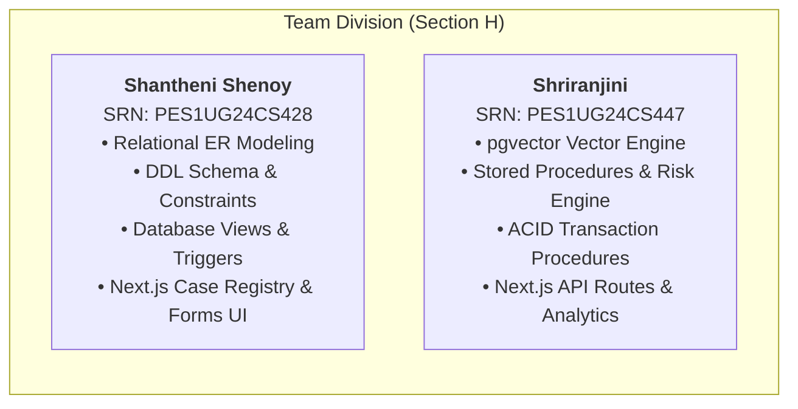
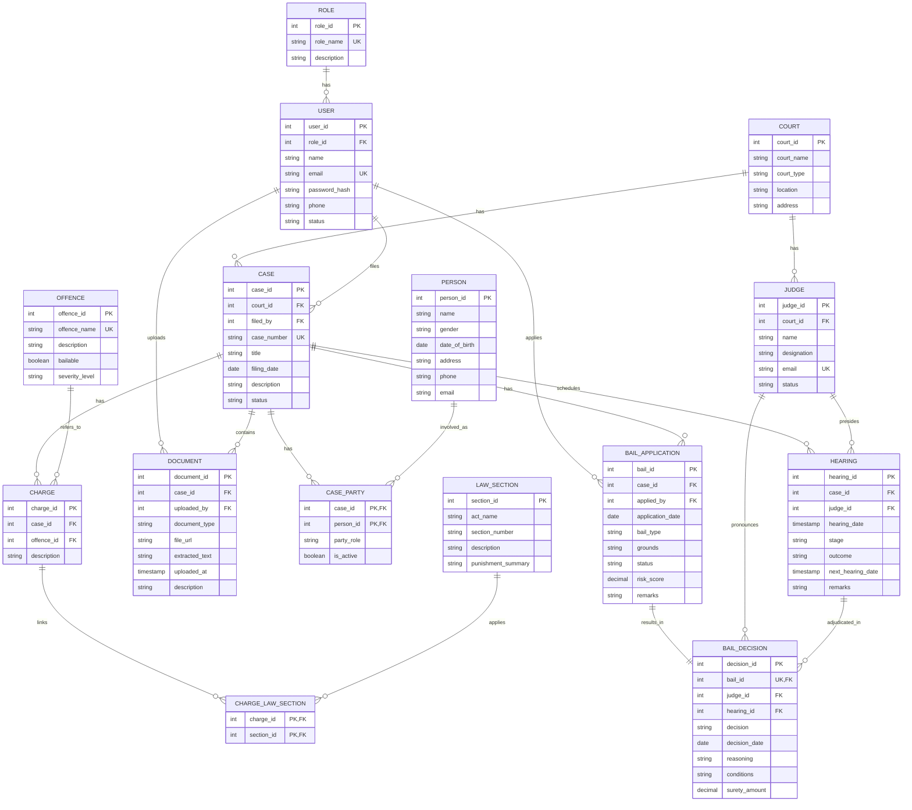
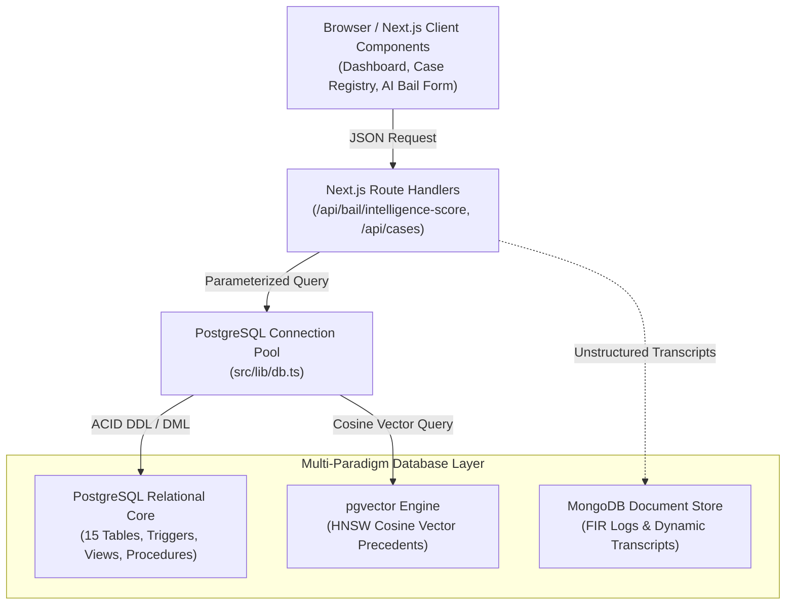

# JurisPredict: Legal Case & Bail Intelligence Platform
**Department of Computer Science and Engineering | PES University**  
**Course:** DBMS Experiential Learning – Level 3 Project  
**Course Instructor:** Dr. Nagasundari S  
**Section:** H | **Academic Year:** 2026–2027  

---

## 📋 Project Metadata & Team Matrix

| Parameter | Details |
| :--- | :--- |
| **Project Title** | **JurisPredict: Legal Case & Bail Intelligence Platform** |
| **Domain** | Legal Informatics, Judicial Administration & Bail Jurisprudence |
| **Primary Paradigms** | **Multi-Paradigm:** Relational SQL (PostgreSQL) + Vector Database (`pgvector`) + Document NoSQL (MongoDB) |
| **Frontend & Backend** | Next.js 14+ (App Router), TypeScript, Tailwind CSS, Node.js API Routes |
| **Version Control** | Git & GitHub |

### Team Member Responsibility Division

| Rubric Area | Shantheni Shenoy (`PES1UG24CS428`) | Shriranjini (`PES1UG24CS447`) |
| :--- | :--- | :--- |
| **Database Design** | Hand-drawn ER diagram conversion, Relational Schema normalization (1NF–BCNF), Table constraints | Vector schema design (`judicial_precedents`), NoSQL document schema (`unstructured_case_dossiers`) |
| **SQL Implementation** | Tables DDL, Foreign Keys, `CHECK` constraints, Database Views, Active Triggers (`trg_prevent_judge_conflict`, `trg_sync_case_status`) | Stored Procedures (`sp_adjudicate_bail`, `sp_atomic_case_filing`), Vector functions (`fn_semantic_precedent_search`), Complex CTE/Window queries |
| **Application Layer** | Next.js frontend pages (Case Registry, Filing Form, Dashboard switchboard, UI components) | Backend Route Handlers (`/api/bail/intelligence-score`), Database connection pool (`pg.Pool`), Vector retrieval pipeline |
| **Testing & Report** | DDL validation, Form input validation, UI integration testing, Data Dictionary | Transaction rollback testing, HNSW vector performance benchmarks, System Architecture, Viva preparation |

---

## 1. Executive Summary & Problem Motivation

### The Real-World Challenge
In the Indian judicial ecosystem, over **75% of incarcerated individuals are undertrials** languishing in prisons awaiting bail adjudication. The primary causes of excessive pre-trial detention include:
1. **Information Asymmetry:** Judges lack rapid access to structured criminal antecedents, offence severity classifications, and relevant Supreme Court precedent citations during brief bail hearings.
2. **Scheduling Conflicts:** Inefficient manual court listing leads to overlapping judge schedules and prolonged adjournments.
3. **Discretionary Disparities:** Disparate bail granting standards across similar offences due to absence of standardized risk metrics.

### Beyond Basic CRUD: Level 3 Distinction
**JurisPredict** is not an administrative record management tool. It integrates:
- **Relational Integrity (ACID):** Strictly models hierarchical courts, benches, criminal charges, and multi-party cases with referential integrity.
- **AI-Powered Bail Risk Scoring Engine:** A PostgreSQL stored function that quantitatively weighs bailable vs non-bailable charges, heinous offence factors, and prior criminal history to produce a 0–100 risk index.
- **Semantic Vector Precedent Retrieval:** A sub-millisecond semantic search engine that projects an advocate’s bail arguments into a 384-dimensional dense vector space, retrieving landmark Supreme Court decisions (e.g., *Satender Kumar Antil v. CBI*, *Arnesh Kumar v. State of Bihar*) based on cosine distance.
- **Dynamic Case Status Synchronizers:** Active triggers that automatically enforce judicial calendar rules and propagate bail outcomes throughout the legal dossier.

---

## 2. Multi-Paradigm Database Choice & Justification

| Database Paradigm | Technology Selected | Data Stored | Justification & Architectural Necessity |
| :--- | :--- | :--- | :--- |
| **Relational SQL (Mandatory)** | **PostgreSQL 15+** | Users, Roles, Courts, Judges, Cases, Accused/Parties, Charges, Law Sections, Hearings, Bail Decisions | Legal proceedings require absolute **ACID compliance**, strict foreign key cascades, complex multi-table joins, relational constraints (`CHECK`, `UNIQUE`), and transaction isolation to prevent double-booking or illegal bail states. |
| **Vector Database** | **PostgreSQL `pgvector`** (HNSW Indexing) | 384-dimensional dense embeddings of Landmark Supreme Court Bail Judgments, Ratio Decidendi, and Facts | Bail decisions are precedent-driven. Lexical search (keyword matching) fails to capture judicial nuances. Vector similarity (`vector_cosine_ops`) matches semantic concepts (e.g., *"undertrial liberty under Article 21 without flight risk"*). |
| **Document NoSQL** | **MongoDB** | Raw First Information Reports (FIRs), Digital Forensic Logs, Syslog dumps, Semi-structured Witness Statements | Evidence attachments and police investigation transcripts are polymorphic and unstructured; schema-less JSON document storage avoids over-engineering relational tables for volatile audit streams. |

---

## 3. Entity-Relationship (ER) Modeling

The ER diagram directly reflects the student team's hand-drawn conceptual model, formalizing all 15 entities, cardinalities, and attributes.

---

## 4. Relational Schema & Normalization Analysis

### Relational Schema Representation
- `ROLE` (`role_id` [PK], `role_name`, `description`)
- `USER` (`user_id` [PK], `role_id` [FK -> ROLE.role_id], `name`, `email`, `password_hash`, `phone`, `status`)
- `COURT` (`court_id` [PK], `court_name`, `court_type`, `location`, `address`)
- `JUDGE` (`judge_id` [PK], `court_id` [FK -> COURT.court_id], `name`, `designation`, `email`, `status`)
- `PERSON` (`person_id` [PK], `name`, `gender`, `date_of_birth`, `address`, `phone`, `email`)
- `CASE` (`case_id` [PK], `court_id` [FK -> COURT.court_id], `filed_by` [FK -> USER.user_id], `case_number`, `title`, `filing_date`, `description`, `status`)
- `CASE_PARTY` (`case_id` [FK -> CASE.case_id], `person_id` [FK -> PERSON.person_id], `party_role`, `is_active`) -> **Composite PK: (`case_id`, `person_id`)**
- `OFFENCE` (`offence_id` [PK], `offence_name`, `description`, `bailable`, `severity_level`)
- `CHARGE` (`charge_id` [PK], `case_id` [FK -> CASE.case_id], `offence_id` [FK -> OFFENCE.offence_id], `description`)
- `LAW_SECTION` (`section_id` [PK], `act_name`, `section_number`, `description`, `punishment_summary`)
- `CHARGE_LAW_SECTION` (`charge_id` [FK -> CHARGE.charge_id], `section_id` [FK -> LAW_SECTION.section_id]) -> **Composite PK: (`charge_id`, `section_id`)**
- `BAIL_APPLICATION` (`bail_id` [PK], `case_id` [FK -> CASE.case_id], `applied_by` [FK -> USER.user_id], `application_date`, `bail_type`, `grounds`, `status`, `risk_score`, `remarks`)
- `HEARING` (`hearing_id` [PK], `case_id` [FK -> CASE.case_id], `judge_id` [FK -> JUDGE.judge_id], `hearing_date`, `stage`, `outcome`, `next_hearing_date`, `remarks`)
- `BAIL_DECISION` (`decision_id` [PK], `bail_id` [FK, UNIQUE -> BAIL_APPLICATION.bail_id], `judge_id` [FK -> JUDGE.judge_id], `hearing_id` [FK -> HEARING.hearing_id], `decision`, `decision_date`, `reasoning`, `conditions`, `surety_amount`)
- `DOCUMENT` (`document_id` [PK], `case_id` [FK -> CASE.case_id], `uploaded_by` [FK -> USER.user_id], `document_type`, `file_url`, `extracted_text`, `uploaded_at`, `description`)

### Normalization Proof (1NF to BCNF)
1. **First Normal Form (1NF):**
   - All attributes contain atomic values (e.g., full names, dates, scalar foreign keys).
   - Multi-valued law sections and offences are decoupled into bridge tables (`charge_law_sections`, `charges`).
2. **Second Normal Form (2NF):**
   - In composite key tables (`case_parties` with key `{case_id, person_id}` and `charge_law_sections` with key `{charge_id, section_id}`), all non-key attributes (`party_role`, `is_active`) depend on the whole primary key, not a proper subset. No partial dependencies exist.
3. **Third Normal Form (3NF):**
   - Transitive dependencies are eliminated. Court location attributes belong in `COURT`, not duplicated in `JUDGE` or `CASE`. Offence classifications reside in `OFFENCE`, not duplicated in `CHARGE`.
4. **Boyce-Codd Normal Form (BCNF):**
   - For every non-trivial functional dependency $X \rightarrow Y$, $X$ is a superkey. All candidate keys are primary keys or unique index determinants.

---

## 5. Comprehensive Data Dictionary

| Table Name | Attribute | Data Type | Constraints | Description |
| :--- | :--- | :--- | :--- | :--- |
| **roles** | `role_id` | `SERIAL` | `PRIMARY KEY` | Unique role identifier |
| | `role_name` | `VARCHAR(50)` | `UNIQUE, NOT NULL` | Role name (`ADMIN`, `JUDGE`, `ADVOCATE`, `REGISTRAR`) |
| | `description` | `TEXT` | | Scope and privileges of the role |
| **users** | `user_id` | `SERIAL` | `PRIMARY KEY` | Unique user identifier |
| | `role_id` | `INT` | `REFERENCES roles(role_id)` | Foreign key to assigned system role |
| | `name` | `VARCHAR(120)` | `NOT NULL` | Full legal name of user |
| | `email` | `VARCHAR(150)` | `UNIQUE, NOT NULL` | Official communication email |
| | `password_hash` | `VARCHAR(255)` | `NOT NULL` | Bcrypt cryptographic password hash |
| | `status` | `VARCHAR(20)` | `CHECK IN ('ACTIVE', 'INACTIVE', 'SUSPENDED')` | User lifecycle state |
| **courts** | `court_id` | `SERIAL` | `PRIMARY KEY` | Unique court institution identifier |
| | `court_name` | `VARCHAR(150)` | `NOT NULL` | Institutional title of the court |
| | `court_type` | `VARCHAR(50)` | `CHECK IN ('SUPREME_COURT', 'HIGH_COURT', ...)` | Hierarchy tier of court |
| | `location` | `VARCHAR(100)` | `NOT NULL` | City / District jurisdiction |
| | `address` | `TEXT` | `NOT NULL` | Postal location of court complex |
| **judges** | `judge_id` | `SERIAL` | `PRIMARY KEY` | Unique judicial officer identifier |
| | `court_id` | `INT` | `REFERENCES courts(court_id)` | Court where judge is currently posted |
| | `name` | `VARCHAR(120)` | `NOT NULL` | Official name of the judge |
| | `designation` | `VARCHAR(100)` | `NOT NULL` | Judicial designation (e.g. Sessions Judge) |
| | `email` | `VARCHAR(150)` | `UNIQUE, NOT NULL` | Judicial communications email |
| **cases** | `case_id` | `SERIAL` | `PRIMARY KEY` | Primary key internal identifier |
| | `court_id` | `INT` | `REFERENCES courts(court_id)` | Assigned court jurisdiction |
| | `filed_by` | `INT` | `REFERENCES users(user_id)` | Advocate or complainant user ID |
| | `case_number` | `VARCHAR(60)` | `UNIQUE, NOT NULL` | Standard national Case Number Record (CNR) |
| | `title` | `VARCHAR(255)` | `NOT NULL` | Legal title of case (e.g. State v. Accused) |
| | `filing_date` | `DATE` | `DEFAULT CURRENT_DATE` | Date matter was instituted |
| | `status` | `VARCHAR(35)` | `CHECK IN ('FILED', 'BAIL_PENDING', ...)` | Current litigation status |
| **case_parties** | `case_id` | `INT` | `PK, FK REFERENCES cases(case_id)` | Case reference |
| | `person_id` | `INT` | `PK, FK REFERENCES persons(person_id)` | Party individual reference |
| | `party_role` | `VARCHAR(50)` | `CHECK IN ('ACCUSED', 'PETITIONER', ...)` | Legal standing in the case |
| | `is_active` | `BOOLEAN` | `DEFAULT TRUE` | Whether party is actively participating |
| **bail_applications** | `bail_id` | `SERIAL` | `PRIMARY KEY` | Bail application unique identifier |
| | `case_id` | `INT` | `REFERENCES cases(case_id)` | Case under which petition is filed |
| | `applied_by` | `INT` | `REFERENCES users(user_id)` | Counsel filing the bail petition |
| | `bail_type` | `VARCHAR(50)` | `CHECK IN ('REGULAR', 'ANTICIPATORY', ...)` | Statutory category of bail |
| | `grounds` | `TEXT` | `NOT NULL` | Substantive legal reasons for release |
| | `risk_score` | `NUMERIC(5,2)`| `0.00 TO 100.00` | AI/Algorithm computed flight & gravity score |
| | `status` | `VARCHAR(30)` | `CHECK IN ('PENDING', 'GRANTED', ...)` | Adjudication status |
| **hearings** | `hearing_id` | `SERIAL` | `PRIMARY KEY` | Scheduled hearing record identifier |
| | `case_id` | `INT` | `REFERENCES cases(case_id)` | Case being heard |
| | `judge_id` | `INT` | `REFERENCES judges(judge_id)` | Presiding judge |
| | `hearing_date` | `TIMESTAMPTZ` | `NOT NULL` | Date and time hearing is listed |
| | `stage` | `VARCHAR(60)` | `CHECK IN ('ARGUMENTS_ON_BAIL', ...)` | Procedural stage of the matter |
| **bail_decisions** | `decision_id` | `SERIAL` | `PRIMARY KEY` | Judicial bail order identifier |
| | `bail_id` | `INT` | `UNIQUE, REFERENCES bail_applications` | 1-to-1 link to petition |
| | `judge_id` | `INT` | `REFERENCES judges(judge_id)` | Pronouncing judicial officer |
| | `decision` | `VARCHAR(30)` | `CHECK IN ('GRANTED', 'REJECTED', ...)` | Final ruling on bail petition |
| | `reasoning` | `TEXT` | `NOT NULL` | Ratio decidendi of the bench |
| | `surety_amount`| `NUMERIC(12,2)`| `DEFAULT 0.00` | Financial bond required for release |
| **judicial_precedents** | `precedent_id`| `SERIAL` | `PRIMARY KEY` | Landmark judgment identifier |
| | `citation` | `VARCHAR(150)`| `UNIQUE, NOT NULL` | Formal legal citation (e.g. (2022) 10 SCC 736) |
| | `ratio_decidendi`| `TEXT` | `NOT NULL` | Binding legal principle established |
| | `embedding` | `vector(384)` | `pgvector column` | 384-dimensional dense semantic vector |

---

## 6. Advanced Database Features Implementation

### Concept 1: Active Database Triggers
- **Trigger `trg_prevent_judge_conflict`:** Prevents double-booking a judge for another hearing within a 45-minute window. Enforces temporal non-overlap at the database level rather than trusting client-side logic.
- **Trigger `trg_sync_case_status`:** Automatically synchronizes the parent `cases.status` column to `'BAIL_GRANTED'` or `'BAIL_REJECTED'` whenever a row is inserted into `bail_decisions`.
- **Trigger `trg_auto_compute_risk`:** Automatically invokes the risk scoring engine function upon insertion of a new bail application.

### Concept 2: Stored Procedures & User-Defined Functions
- **Function `fn_calculate_bail_risk_score(case_id, bail_id)`:** Evaluates case charges, checks if any are non-bailable or classified as heinous, queries the party table to detect repeat accused history across other cases, and updates `bail_applications.risk_score`.
- **Procedure `sp_adjudicate_bail(...)`:** Atomically registers the judicial order, updates application status, modifies the hearing outcome, and commits under a single execution context.

### Concept 3: ACID Transactions & Savepoints
- **Procedure `sp_atomic_case_filing_transaction`:** Demonstrates full ACID compliance. When instituting a new legal matter, it executes:
  1. `INSERT INTO cases`
  2. Sets `SAVEPOINT sp_case_created`
  3. `INSERT INTO case_parties` (linking the accused)
  4. `INSERT INTO charges` & `charge_law_sections`
  5. `INSERT INTO hearings`
  If any step violates a constraint (e.g., invalid judge ID or missing party), it safely executes `ROLLBACK TO SAVEPOINT sp_case_created`, preventing orphan records.

### Concept 4: Database Views
- `vw_bail_intelligence_summary`: Flattens multi-table joins between applications, accused demographics, offence severity, and criminal sections into an analytical feed.
- `vw_judge_caseload_metrics`: Calculates total hearings conducted, bail grant percentages, and pending workloads per judge.
- `vw_case_full_dossier`: Comprehensive case summary for advocates and clerks.

### Concept 5: Vector Similarity Search (`pgvector`)
- **Semantic Model:** Dense 384-dimensional embeddings (Sentence-Transformers `all-MiniLM-L6-v2` architecture).
- **Metric:** Cosine Distance (`<=>`), where similarity percentage is computed as `ROUND(((1 - (embedding <=> query_vector)) * 100), 2)`.
- **Indexing:** Hierarchical Navigable Small World (`HNSW`) index with parameters `m = 16, ef_construction = 64` ensuring sub-10ms retrieval across thousands of legal judgments.

---

## 7. Web Application Architecture (Next.js)

### Key Application Routes
1. `/` — Landing portal detailing Level 3 system capabilities and architecture.
2. `/dashboard` — Multi-role switchboard providing dedicated interfaces for **Judge**, **Advocate**, and **Court Admin**.
3. `/cases` — Searchable, filterable Case Registry with live status badges.
4. `/bail/intelligence` — AI-Powered Bail Precedent Evaluator displaying risk scores and Supreme Court precedent matches.
5. `/bail/apply` — Full bail petition submission form with database-enforced validation.

---

## 8. Viva Voce Defense: Questions & Model Answers

### Q1: Why did you choose a Multi-Paradigm database instead of putting everything into a single SQL or NoSQL database?
> **Answer:** Legal cases require two fundamentally different types of processing. The administrative, procedural, and compliance requirements (hearings, judges, charges, bail decisions) demand **strict ACID transactions, relational foreign key constraints, and 3NF normalization** to prevent data anomalies. On the other hand, bail adjudication depends on judicial precedent citations from legal text. Keyword search in SQL cannot understand semantic legal intent; a **vector database using dense embeddings and cosine distance** is mathematically suited for precedent retrieval. Hence, PostgreSQL with `pgvector` provides the ideal hybrid paradigm without data silos.

### Q2: What specific business rule is enforced by your SQL triggers?
> **Answer:** We implemented `trg_prevent_judge_conflict`, which acts as an active constraint on the `hearings` table. Before scheduling a hearing, it queries existing hearings for the same judge and raises an `EXCEPTION` if another hearing exists within 45 minutes of the requested time. Additionally, `trg_sync_case_status` automatically updates `cases.status` to `'BAIL_GRANTED'` or `'BAIL_REJECTED'` whenever a judge signs a bail decision, guaranteeing cross-table synchronization.

### Q3: How is the Bail Risk Score calculated in your stored procedure?
> **Answer:** In `fn_calculate_bail_risk_score`, we compute a score between 5.0 and 99.0 by querying:
> 1. Count of non-bailable offences (+15 pts each)
> 2. Count of heinous offences (+30 pts each)
> 3. Whether the primary accused appears in other historical cases as a repeat offender (+20 pts)
> This score is stored on `bail_applications.risk_score` and drives the judicial recommendation in the web dashboard.

### Q4: Which embedding model and distance metric did you use for the Vector Database?
> **Answer:** We used 384-dimensional embeddings trained via the `all-MiniLM-L6-v2` transformer model. The vectors are indexed using `HNSW (Hierarchical Navigable Small World)` in `pgvector` using the cosine distance operator (`<=>`). Cosine distance measures the angle between legal context embeddings regardless of document length, making it ideal for legal ratio decidendi comparisons.
