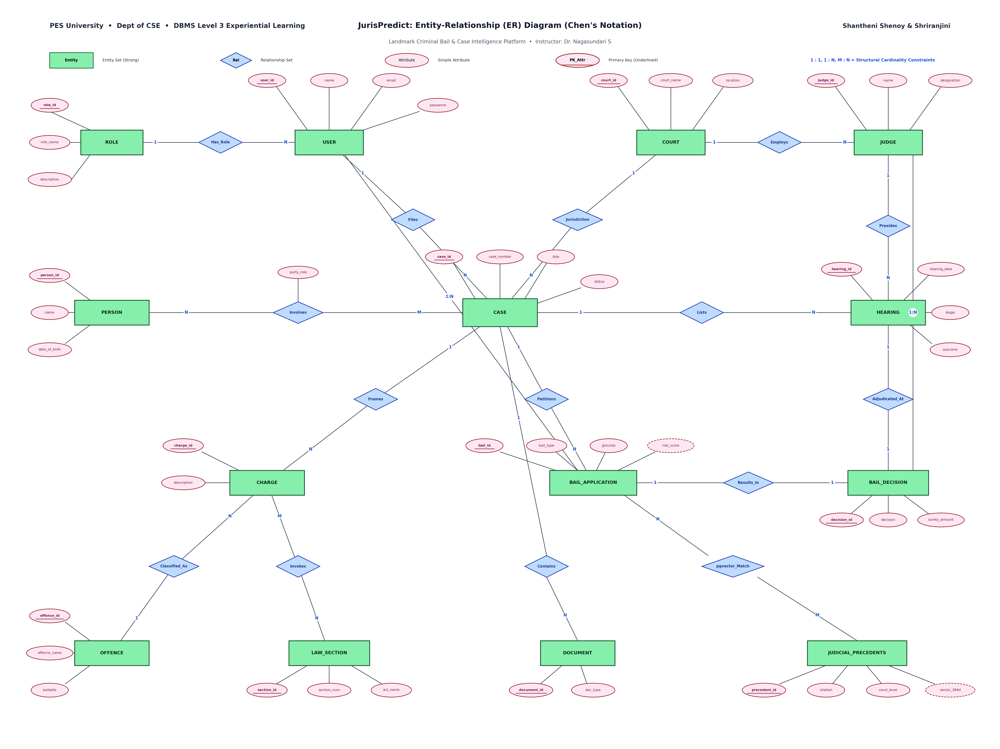
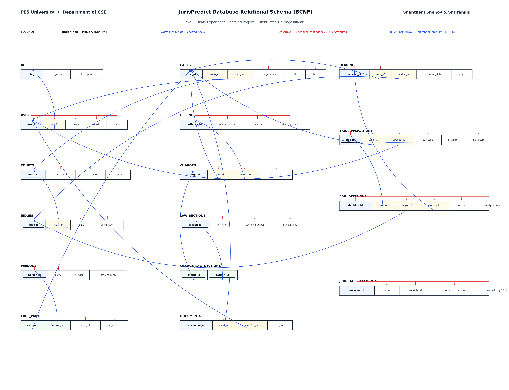

# JurisPredict: Complete Relational Schema & Entity-Relationship (ER) Documentation
**Department of Computer Science and Engineering | PES University**  
**Course:** DBMS Experiential Learning – Level 3 Project  
**Course Instructor:** Dr. Nagasundari S | **Academic Year:** 2026–2027  
**Team Members:** Shantheni Shenoy (`PES1UG24CS428`) & Shriranjini (`PES1UG24CS447`)

---

## 🖼️ Visual Academic Diagrams

### 1. Chen's Notation Entity-Relationship (ER) Diagram
*Matching standard academic format: Green Entity Rectangles, Blue Relationship Diamonds, Pink Attribute Ovals, and Structural Cardinality Constraints.*

---

### 2. Relational Schema Diagram (3NF / BCNF)
*Matching standard textbook format (Bob Dewhurst / Elmasri & Navathe): Horizontal relation blocks, underlined Primary Keys, dotted Foreign Keys, red Functional Dependency overhead arrows, and blue Referential Integrity arrows.*

---

## 📌 Section 1: Entity-Relationship (ER) Specifications

### 1.1 ER Cardinalities & Structural Constraints

| Entity 1 | Cardinality | Entity 2 | Relationship Set | Integrity Rule / Business Logic |
| :--- | :---: | :--- | :---: | :--- |
| **ROLE** | `1 : N` | **USER** | `Has_Role` | One role groups many users; `role_id` is mandatory foreign key. |
| **COURT** | `1 : N` | **JUDGE** | `Employs` | A court institution employs multiple judicial officers. |
| **COURT** | `1 : N` | **CASE** | `Jurisdiction` | A court exercises territorial jurisdiction over cases. |
| **USER** | `1 : N` | **CASE** | `Files` | An advocate or registrar files legal cases into the system. |
| **USER** | `1 : N` | **BAIL_APP** | `Applies` | An advocate submits multiple bail petitions. |
| **USER** | `1 : N` | **DOCUMENT** | `Uploads` | Users upload evidence, chargesheets, and forensic copies. |
| **CASE** | `M : N` | **PERSON** | `Involves` | Decomposed via associative entity **`CASE_PARTY`** with attribute `party_role`. Composite PK: `(case_id, person_id)`. |
| **CASE** | `1 : N` | **CHARGE** | `Frames` | A case has one or more criminal charges framed by prosecution. |
| **OFFENCE**| `1 : N` | **CHARGE** | `Classified_As`| Statutory offence definitions categorized as bailable/heinous. |
| **CHARGE** | `M : N` | **LAW_SECTION** | `Invokes` | Decomposed via associative entity **`CHARGE_LAW_SECTION`**. Composite PK: `(charge_id, section_id)`. |
| **CASE** | `1 : N` | **BAIL_APP** | `Petitions` | Successive regular, anticipatory, or interim bail applications. |
| **BAIL_APP**| **`1 : 1`** | **BAIL_DECISION**| `Results_In`| Mandatory 1-to-1: each application receives at most **one** final decision (`bail_id` is `UNIQUE`). |
| **JUDGE** | `1 : N` | **BAIL_DECISION**| `Pronounces`| Judicial officers sign binding bail orders. |
| **HEARING**| `1 : 0..1`| **BAIL_DECISION**| `Adjudicated_At`| Bail orders are pronounced during scheduled hearings. |
| **CASE** | `1 : N` | **HEARING** | `Lists` | Sequential hearing stages from first hearing to final order. |
| **JUDGE** | `1 : N` | **HEARING** | `Presides` | Presiding judge listing. Controlled by `trg_prevent_judge_conflict` (45 min buffer). |
| **CASE** | `1 : N` | **DOCUMENT** | `Contains` | FIR transcripts, cyber logs, medical affidavits. |
| **BAIL_APP**| `N : M` | **JUDICIAL_PRECEDENTS**| `pgvector_Match`| Dense 384-dimensional semantic similarity search (`<=>` cosine distance). |

---

## 📌 Section 2: Relational Schema Specification

### 2.1 Standard Relational Schema Notation

Underlined attributes denote **Primary Keys (`<u>attribute</u>`)**, asterisks or bold text denote **Foreign Keys (`attribute*`)**, and composite keys are underlined together.

1. **`roles`** (
   <u>`role_id`</u>, 
   `role_name`, 
   `description`, 
   `created_at`
)

2. **`users`** (
   <u>`user_id`</u>, 
   `role_id`*, 
   `name`, 
   `email`, 
   `password_hash`, 
   `phone`, 
   `status`, 
   `created_at`
)  
   *FK: `role_id` REFERENCES `roles(role_id)` ON DELETE RESTRICT*

3. **`courts`** (
   <u>`court_id`</u>, 
   `court_name`, 
   `court_type`, 
   `location`, 
   `address`, 
   `created_at`
)

4. **`judges`** (
   <u>`judge_id`</u>, 
   `court_id`*, 
   `name`, 
   `designation`, 
   `email`, 
   `status`, 
   `created_at`
)  
   *FK: `court_id` REFERENCES `courts(court_id)` ON DELETE RESTRICT*

5. **`persons`** (
   <u>`person_id`</u>, 
   `name`, 
   `gender`, 
   `date_of_birth`, 
   `address`, 
   `phone`, 
   `email`, 
   `created_at`
)

6. **`cases`** (
   <u>`case_id`</u>, 
   `court_id`*, 
   `filed_by`*, 
   `case_number`, 
   `title`, 
   `filing_date`, 
   `description`, 
   `status`, 
   `priority_level`, 
   `updated_at`
)  
   *FK1: `court_id` REFERENCES `courts(court_id)` ON DELETE RESTRICT*  
   *FK2: `filed_by` REFERENCES `users(user_id)` ON DELETE RESTRICT*

7. **`case_parties`** (
   <u>`case_id`*, `person_id`*</u>, 
   `party_role`, 
   `is_active`, 
   `created_at`
)  
   *Composite Primary Key: (`case_id`, `person_id`)*  
   *FK1: `case_id` REFERENCES `cases(case_id)` ON DELETE CASCADE*  
   *FK2: `person_id` REFERENCES `persons(person_id)` ON DELETE RESTRICT*

8. **`offences`** (
   <u>`offence_id`</u>, 
   `offence_name`, 
   `description`, 
   `bailable`, 
   `severity_level`
)

9. **`charges`** (
   <u>`charge_id`</u>, 
   `case_id`*, 
   `offence_id`*, 
   `description`, 
   `created_at`
)  
   *FK1: `case_id` REFERENCES `cases(case_id)` ON DELETE CASCADE*  
   *FK2: `offence_id` REFERENCES `offences(offence_id)` ON DELETE RESTRICT*

10. **`law_sections`** (
    <u>`section_id`</u>, 
    `act_name`, 
    `section_number`, 
    `description`, 
    `punishment_summary`
)  
    *Candidate Key: UNIQUE (`act_name`, `section_number`)*

11. **`charge_law_sections`** (
    <u>`charge_id`*, `section_id`*</u>
)  
    *Composite Primary Key: (`charge_id`, `section_id`)*  
    *FK1: `charge_id` REFERENCES `charges(charge_id)` ON DELETE CASCADE*  
    *FK2: `section_id` REFERENCES `law_sections(section_id)` ON DELETE RESTRICT*

12. **`bail_applications`** (
    <u>`bail_id`</u>, 
    `case_id`*, 
    `applied_by`*, 
    `application_date`, 
    `bail_type`, 
    `grounds`, 
    `status`, 
    `risk_score`, 
    `remarks`, 
    `created_at`
)  
    *FK1: `case_id` REFERENCES `cases(case_id)` ON DELETE CASCADE*  
    *FK2: `applied_by` REFERENCES `users(user_id)` ON DELETE RESTRICT*

13. **`hearings`** (
    <u>`hearing_id`</u>, 
    `case_id`*, 
    `judge_id`*, 
    `hearing_date`, 
    `stage`, 
    `outcome`, 
    `next_hearing_date`, 
    `remarks`
)  
    *FK1: `case_id` REFERENCES `cases(case_id)` ON DELETE CASCADE*  
    *FK2: `judge_id` REFERENCES `judges(judge_id)` ON DELETE RESTRICT*

14. **`bail_decisions`** (
    <u>`decision_id`</u>, 
    `bail_id`* [UNIQUE], 
    `judge_id`*, 
    `hearing_id`*, 
    `decision`, 
    `decision_date`, 
    `reasoning`, 
    `conditions`, 
    `surety_amount`, 
    `created_at`
)  
    *1:1 Constraint: `bail_id` is UNIQUE*  
    *FK1: `bail_id` REFERENCES `bail_applications(bail_id)` ON DELETE CASCADE*  
    *FK2: `judge_id` REFERENCES `judges(judge_id)` ON DELETE RESTRICT*  
    *FK3: `hearing_id` REFERENCES `hearings(hearing_id)` ON DELETE SET NULL*

15. **`documents`** (
    <u>`document_id`</u>, 
    `case_id`*, 
    `uploaded_by`*, 
    `document_type`, 
    `file_url`, 
    `extracted_text`, 
    `uploaded_at`, 
    `description`
)  
    *FK1: `case_id` REFERENCES `cases(case_id)` ON DELETE CASCADE*  
    *FK2: `uploaded_by` REFERENCES `users(user_id)` ON DELETE RESTRICT*

16. **`judicial_precedents`** [Vector Database Extension] (
    <u>`precedent_id`</u>, 
    `citation` [UNIQUE], 
    `court_level`, 
    `bench`, 
    `judgment_year`, 
    `offence_categories`, 
    `facts_summary`, 
    `ratio_decidendi`, 
    `decision_outcome`, 
    `embedding` [vector(384)], 
    `created_at`
)

---

## 📌 Section 3: Schema Normalization Proof (1NF to BCNF)

### 1. First Normal Form (1NF)
* **Rule:** Every attribute contains only atomic (indivisible) values; no repeating groups or arrays.
* **Proof:** Multi-valued offences and sections are decoupled into bridge tables (`charges`, `charge_law_sections`). All attributes represent scalar values.

### 2. Second Normal Form (2NF)
* **Rule:** Table must be in 1NF and have NO partial dependencies (all non-prime attributes must depend on the whole candidate key).
* **Proof:** In composite key tables (`case_parties` with key `{case_id, person_id}`), `party_role` and `is_active` depend strictly on both attributes. Neither attribute is partially dependent.

### 3. Third Normal Form (3NF)
* **Rule:** Table must be in 2NF and have NO transitive dependencies ($X \rightarrow Y$ and $Y \rightarrow Z$).
* **Proof:** Institutional court data belongs only in `courts`, not duplicated in `judges` or `cases`. Offence severity belongs in `offences`, not in `charges`.

### 4. Boyce-Codd Normal Form (BCNF)
* **Rule:** For every non-trivial functional dependency $X \rightarrow Y$, $X$ must be a superkey.
* **Proof:** In all 15 tables, every determinant is either a candidate key or primary key. No anomalous dependencies exist.
